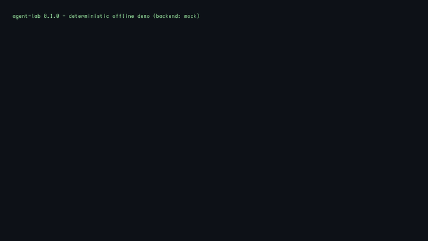

# agent-lab

A lean, **zero-dependency** AI agent framework in pure Python — tool use and
function calling, persistent memory, and workflow automation. It is the
patterns I run daily in my own [Hermes](https://hermes-agent.nousresearch.com)/
opencode agent pipelines, packaged into one small, readable, tested codebase.



> The animation above is a **real run** of `python -m agentlab demo` — no
> network, no API keys, fully deterministic (mock backend). Swap in any
> OpenAI-compatible model with one env var.

---

## What it demonstrates

| Pattern | Where | Why it matters for production agents |
|---|---|---|
| **Function calling** | `agentlab/tools.py`, `agentlab/agent.py` | JSON schemas derived from typed signatures + docstrings; safe, never-raising execution; loop guard against repeated calls |
| **Memory / context handling** | `agentlab/memory.py`, `agentlab/agent.py` | JSONL memory store with keyword+recency recall; hard context budget with oldest-tool-exchange trimming; session *logs* never masquerade as *facts* |
| **Workflow automation** | `agentlab/workflow.py` | Explicit state machines: retries with backoff, guarded steps, saga-style compensation |
| **Provider abstraction** | `agentlab/llm.py` | One `chat()` contract; deterministic offline `MockBackend` for tests/CI, `OpenAICompatBackend` for any real endpoint (OpenAI, OpenRouter free tiers, Ollama, vLLM) |

Runs on **Python 3.10+, standard library only** — `pip install` is optional
and there are zero runtime dependencies to audit.

## Architecture

```
                    ┌──────────────────────────────────────────────┐
   user task        │                    Agent                      │
 ─────────────────► │  system prompt ──► context budget ──► replies  │
                    │                                              │
                    │   backend.chat(messages, tools=schemas)      │
                    │        │                          ▲           │
                    │        ▼                          │           │
                    │   ┌──────────┐   tool results     │           │
                    │   │ ToolRegistry.call(name,args)  ────────────┤
                    │   └────┬─────┘   (never raises)   │           │
                    └────────┼──────────────────────────┘           │
                             ▼                                     │
              ┌──────────────────┐       ┌───────────────────┐     │
              │  tool functions  │       │  Memory (JSONL)   │     │
              │  schemas from    │       │  recall: keyword+ │     │
              │  type hints      │       │  recency scoring  │─────┘
              └──────────────────┘       └───────────────────┘
```

```
 workflow: lead_triage                    workflow: release
  [score_lead]     keyword scoring          [validate_version]  semver gate
  [decide]         apply / watch / pass      [run_tests]         retries + backoff
  [log_decision]   guarded, stateful         [create_tag]        compensate on failure
  [notify]         retries, on_error=skip    [notify]            guarded
```

## Quickstart

```bash
git clone https://github.com/pxlcrtiv/agent-lab.git
cd agent-lab
python3 -m agentlab run "What time is it in London?"    # no install step
python3 -m agentlab chat                                # interactive REPL
python3 -m agentlab workflow examples/lead_triage.py \
    --state role_type=ai-agent-engineer remote=true visa=true
python3 -m unittest discover -s tests -v                # 33 tests, no deps
```

That first command already shows the loop: the agent calls the `clock` tool,
gets a result, and answers. Watch the `-> tool call` / `<- tool res` trace.

### Using a real model

```bash
export OPENAI_API_KEY=sk-...                 # any OpenAI-compatible endpoint:
export OPENAI_BASE_URL=https://api.openai.com/v1   # OpenAI, OpenRouter free
export OPENAI_MODEL=gpt-4o-mini                    # tiers, Ollama, vLLM, ...
python3 -m agentlab run "..." --backend openai
```

The mock backend is used by default so CI, tests, and this README's demo are
hermetic. The OpenAI-compatible backend talks HTTP through stdlib `urllib`
only.

## Design notes worth stealing

- **Schemas can't drift.** `@tool` derives the JSON schema from the
  annotated signature and the docstring's `Args:` section — one definition
  per tool, and it survives `from __future__ import annotations`.
- **Tool calls never raise.** `ToolRegistry.call()` returns
  `{"ok": bool, ...}`; the agent feeds that straight back to the model, so a
  crashing tool degrades to a model-visible message instead of killing the run.
- **Context has a budget.** The transcript is trimmed to a char budget by
  dropping the *oldest tool exchanges* first — system prompt, current task
  and latest exchange always survive.
- **Facts ≠ logs.** Memory entries are typed (`note`, `fact`, `session`);
  recall and the LLM context seeder only see `note`/`fact`, so conversation
  logs never pollute what the model believes.
- **Safe by default.** The calculator tool whitelists AST nodes (no `eval`),
  `fetch` is read-only with a size cap, and the loop has a "repeated
  identical tool call" guard.

## Repository layout

```
agentlab/            the framework (stdlib only)
  llm.py             backends: MockBackend, OpenAICompatBackend
  tools.py           @tool decorator, ToolRegistry, schema derivation
  agent.py           the agent loop + context trimming + loop guard
  memory.py          JSONL memory store with scoring recall
  workflow.py        state-machine engine: retries, guards, compensation
  builtin_tools.py   clock, safe calculator, fetch, notes, todo
  cli.py             run / chat / workflow / demo commands
examples/            lead_triage.py (job-lead routing), release.py (CI-ish)
tests/               33 unit tests — unittest, no dependencies
demo/                make_demo.sh + render_gif.py rebuild the README GIF
.github/workflows/   CI: tests + CLI smoke tests on Python 3.10/3.11/3.12
```

## License

MIT — see [LICENSE](LICENSE).